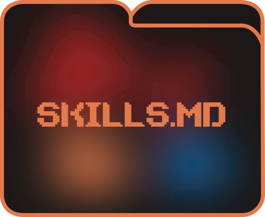
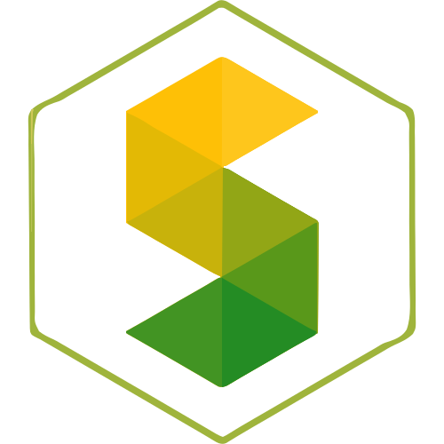

<!-- Don't delete it -->
<div name="readme-top"></div>

<!-- Organization Logo -->
<div align="center" style="display: flex; align-items: center; justify-content: center; gap: 16px;">
  
  
  
</div>

&nbsp;

<!-- Organization/Project Badges -->
<div align="center">

[](https://aossie.org/)
[](./BestPracticesChecklist.md)

</div>

<!-- Organization/Project Social Handles -->
<p align="center">
<!-- Telegram -->
<a href="https://t.me/StabilityNexus">
</a>
&nbsp;&nbsp;
<!-- X (formerly Twitter) -->
<a href="https://x.com/aossie_org">
</a>
&nbsp;&nbsp;
<!-- Discord -->
<a href="https://discord.gg/hjUhu33uAn">
</a>
&nbsp;&nbsp;
<!-- Medium -->
<a href="https://news.stability.nexus/">
  </a>
&nbsp;&nbsp;
<!-- LinkedIn -->
<a href="https://www.linkedin.com/company/aossie/">
  </a>
&nbsp;&nbsp;
<!-- Youtube -->
<a href="https://www.youtube.com/@AOSSIE-Org">
  </a>
</p>

---

<div align="center">
<h1>AOSSIE Skills</h1>
<h3>Organization-wide skills for AI coding agents</h3>
</div>

This repository holds the **general, organization-wide skills** shared by every AOSSIE project. Each skill is a `SKILL.md` file that tells an AI coding agent (Claude Code, Cursor, Copilot, etc.) how to behave when working on an AOSSIE repository: how to onboard a contributor, which AI-usage and disclosure rules to follow, which architecture standards apply, and how to use MCP servers.

Skills here are deliberately **project-agnostic**. Anything specific to a single repository (its architecture, boundaries, setup) belongs in that repository's own `AGENTS.md` and `.agent/` folder, not here.

---

## 📚 Skills

| Skill | Name | Use it when |
|---|---|---|
| [`contributor-onboarding`](./contributor-onboarding/SKILL.md) | `aossie-contributor-onboarding` | A contributor connects for the first time, asks "how do I start" or "what should I read", or begins any contribution-related conversation. |
| [`GIT-DIS-AIPolicy`](./GIT-DIS-AIPolicy/SKILL.md) | `aossie-ai-policy` | An agent creates issues, writes PR descriptions, or drafts Discord messages for an AOSSIE repository. |
| [`project-template`](./project-template/SKILL.md) | `aossie-project-template` | Proposing or implementing new features, files, or structural changes (Next.js, React, microservices, Web3, REST APIs). |
| [`mcp-integration`](./mcp-integration/SKILL.md) | `aossie-mcp-integration` | Setting up and using MCP servers (GitHub, Puppeteer) to automate code changes, UI testing, and PR management. |

Shared terms used across skills (the **bold** words in each `SKILL.md`) are defined in [GLOSSARY.md](./GLOSSARY.md).

---

## 🗂️ Repository Structure

```text
<skill-name>/
├── SKILL.md        # Frontmatter (name, description) + the instructions
├── references/     # Optional: detail files the skill points to, keeping SKILL.md short
└── scripts/        # Optional: runnable helpers that ship with the skill
GLOSSARY.md         # Canonical definitions of shared terms
Brand.md            # Naming and terminology rules for skill/README copy
AGENTS.md           # Instructions for agents working on this repo itself
```

Every `SKILL.md` starts with YAML frontmatter:

```yaml
---
name: aossie-<skill-name>   # kebab-case, prefixed with aossie-
description: <when the agent should use this skill, written as a trigger condition>
---
```

> [!IMPORTANT]
> Folder names, frontmatter fields, and `references/` paths are a **public interface**. Other repositories sync these files, so renaming or moving them breaks those repositories until they re-sync.

---

## 🚀 Using These Skills

**In an AOSSIE repository:** copy the skill folders you need (plus `GLOSSARY.md`) into the repository, for example under `org-wide-skills/`, and point to them from the repository's `AGENTS.md`. Re-sync when skills change here.

**With your own agent:** clone this repository and add the skill folders to your agent's skills directory, for example `.claude/skills/` for Claude Code.

```bash
git clone https://github.com/AOSSIE-Org/Skills.git
```

---

## 🔗 Used By

* **[Skill Bot](https://github.com/AOSSIE-Org/SkillBot)** (Discord Assistant): Answers contributor queries using local and org-wide skill files and logs knowledge gaps. Syncs the skills in this repository into its `org-wide-skills/` folder.
* **[PR Dashboard](https://github.com/AOSSIE-Org/PullRequestDashboard)** (Conflict DAG): Fetches open PRs, extracts summaries, clusters overlapping files, and runs local model inference to render a dependency DAG highlighting merge sequences and conflicts.

---

## 🙌 Contributing

⭐ Don't forget to star this repository if you find it useful! ⭐

To add or change a skill:

1. Check the existing skills and [GLOSSARY.md](./GLOSSARY.md) first, so you don't duplicate a skill's scope.
2. Write the `description` as a trigger condition an agent can match against a request, not as a feature summary.
3. Keep `SKILL.md` short and move detail into `references/`.
4. Add any new shared term to [GLOSSARY.md](./GLOSSARY.md).

See [AGENTS.md](./AGENTS.md) and the [Contribution Guidelines](./CONTRIBUTING.md) for details. All project communication happens on [Discord](https://discord.gg/hjUhu33uAn).

---

## ✨ Maintainers

* [Karun Pacholi](https://github.com/kpj2006) - Lead Developer & Architect
* [zahnentferner](https://github.com/Zahnentferner) - admin & reviewer

---

## 📍 License

This project is licensed under the GNU General Public License v3.0.
See the [LICENSE](LICENSE) file for details.

---

## 💪 Thanks To All Contributors

Thanks a lot for spending your time helping this project grow. Keep rocking 🥂

[](https://github.com/AOSSIE-Org/Skills/graphs/contributors)

© 2026 AOSSIE
